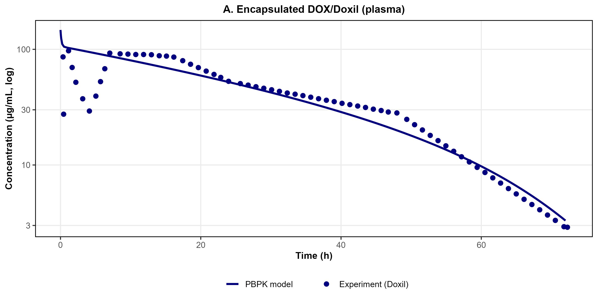
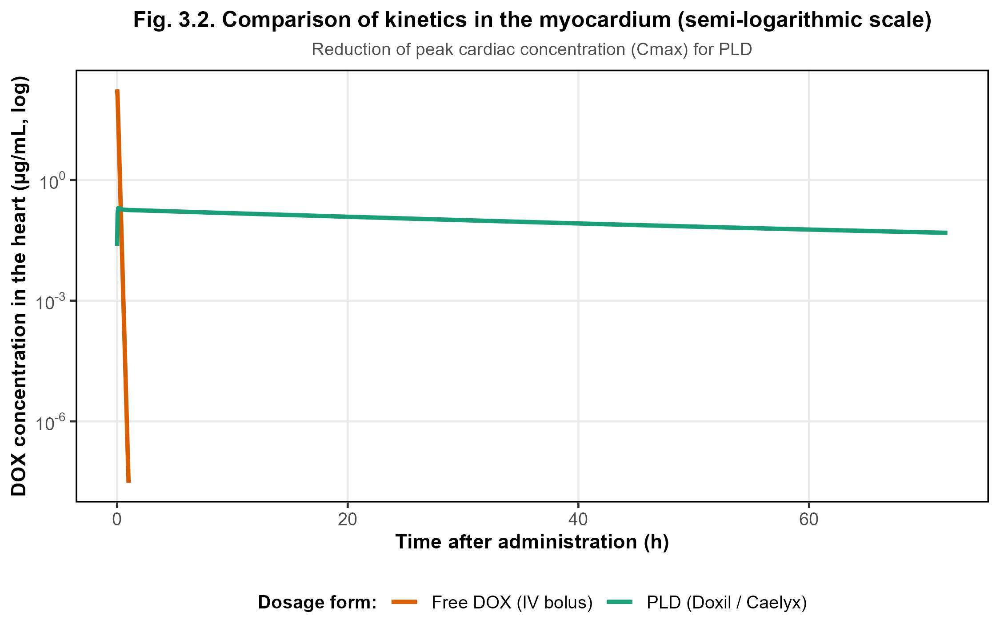
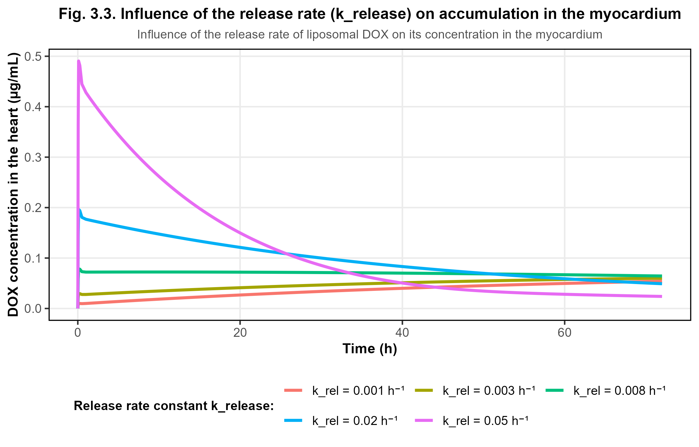
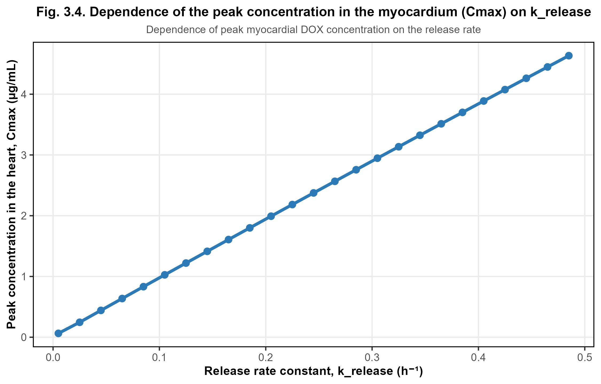

# Liposomal doxorubicin: a minimal hybrid PBPK-type model in R

Mechanistic ODE model of the plasma pharmacokinetics of PEGylated liposomal doxorubicin (Doxil/Caelyx-like) and of free doxorubicin released from the carrier, with a heart compartment for exploring how the **release rate (`k_release`)** affects peak myocardial exposure.

> **Status: v0.1, work in progress** (master's thesis project). Calibration is done on one digitized plasma profile; the model is not externally validated yet. See [Status and limitations](#status-and-limitations).

## Model

Six states (amounts in µg), mouse 25 g, 5 mg/kg IV (125 µg):

| Liposomal DOX | Free DOX |
|---|---|
| plasma (`A_NP_pl`) | plasma (`A_DOX_pl`) |
| mononuclear phagocyte system, MPS (`A_MPS`) | heart (`A_heart`) |
| tumour (`A_tum_NP`) | tumour (`A_tum`) |

- Saturable (Michaelis-Menten) liposome uptake by the MPS; first-order degradation in the MPS releases free DOX into plasma.
- First-order liposome exchange plasma ⇄ tumour (EPR); first-order DOX release in plasma and tumour.
- Perfusion-limited exchange of free DOX between plasma and heart (`Q_heart`, `Kp_heart`); first-order systemic clearance (`CL_tot`).
- Solver: LSODA (`deSolve`). Calibration: `optim` (Nelder-Mead) on log10 concentrations.

## Quick start

```r
install.packages(c("deSolve", "ggplot2", "dplyr", "scales"))
```

```bash
Rscript run_all.R     # from the repository root, ~1 min
```

Writes figures to `figures/`, tables to `results/` and `sessionInfo.txt`.

## Repository layout

| Path | Content |
|---|---|
| `R/setup.R` | packages, plot theme |
| `R/model.R` | fixed parameters, ODE system, initial states |
| `R/data.R` | loads digitized data |
| `R/calibration.R` | objective function, optimisation, fit metrics |
| `R/simulate.R` | baseline, free-DOX and `k_release` scans |
| `R/figures.R` | Figures 3.1-3.4 |
| `data/` | digitized plasma profiles (CSV, ng/mL) |
| `results/` | calibrated parameters, fit metrics, Cmax tables |

## Data

Plasma concentration-time profiles of total doxorubicin after Doxil and after free doxorubicin (mouse, 5 mg/kg IV) were digitized from Fig. 1A of:

Luo R, Li Y, He M, et al. *Distinct biodistribution of doxorubicin and the altered dispositions mediated by different liposomal formulations.* Int J Pharm 2017;519:1-10. doi:10.1016/j.ijpharm.2017.01.002

Digitization: WebPlotDigitizer. Points are nodes along the plotted curves, not independent observations (the paper has 13 sampling times, n = 3 per time).

## Results

### Figure 3.1. Calibration of the liposomal DOX model



### Figure 3.2. Free DOX vs. liposomal DOX in the heart



### Figure 3.3. Sensitivity analysis of the release rate



### Figure 3.4. Dependence of myocardial Cmax on k_release



Fit to the Doxil profile (`results/fit_metrics.csv`): median fold error 0.94, 97% of points within 0.3-3-fold, MAPE 27%.

## Status and limitations

- **Calibration data.** Only plasma total DOX after Doxil is informative. MPS, tumour and heart states are not constrained by data, so `k_pt`, `k_tp`, `k_tp_DOX`, `k_deg` and `k_release` are weakly identifiable. A test run with other values of `Kp_heart` and `CL_tot` gave an equally good plasma fit with `k_release` about three orders of magnitude lower.
- **Free-DOX arm.** It is part of the objective but does not depend on any calibrated parameter, and the model (one plasma volume, no peripheral distribution of free DOX) cannot reproduce the observed free-DOX profile. The free-DOX curve in Fig. 3.2 is illustrative; the free-vs-liposomal peak ratio is not a validated estimate.
- **Heart.** Heart concentration is free DOX only and no heart data are used in calibration.
- **No external validation** in this version.
- `Kp_heart` and `CL_tot` are adjusted values; they differ from the literature-derived values in the thesis text.
- Single optimiser start; no multi-start or uncertainty analysis yet.

## License

MIT, see `LICENSE`.
